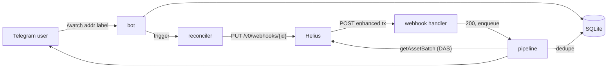
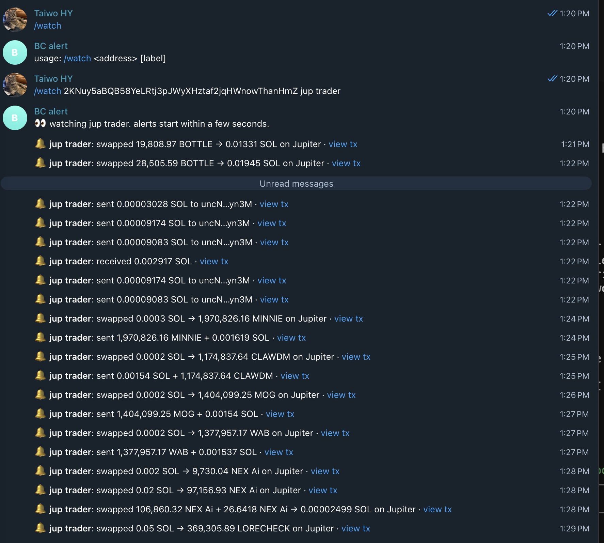

# Real-time Solana wallet alerts in Go with Helius webhooks

**Try it:** Message [@bc_helios_alertbot](https://t.me/bc_helios_alertbot) on Telegram — demo limits apply.

I've built Telegram crypto bots before. Every one of them had the same loop at its
core: wake up, ask an RPC node "anything new for this address?", sleep, repeat. It
works until you're watching fifty wallets, your provider starts returning 429s, and
your "real-time" alerts show up thirty seconds late.

I had never used Helius. Their data platform is pitched at exactly this problem, so I
set myself a small project to learn it properly: a Telegram bot where you type
`/watch <address> <label>` and get a message like this whenever that wallet does
something:

```
🔔 jup trader: swapped 0.08221 SOL → 828,678.81 GROK on Jupiter · view tx
```

That's a real alert from the test run, not a mockup. The service is called
**solwatch**. It's about 2,200 lines of Go (plus 800 lines of tests), using only the
standard library and a SQLite driver. This post covers how I chose between the ways Helius can push data to
you, how the webhook flow works end to end, and a friction log of everything that
tripped me up as a first-time user.

The code is in the repo next to this post.

## Four ways to hear about a transaction

Before writing code I wanted to know my options. Helius offers several, and the
tradeoffs aren't obvious from the marketing pages. Here's what I put together from
their docs ([data streaming overview](https://www.helius.dev/docs/data-streaming),
[credits](https://www.helius.dev/docs/billing/credits),
[plans](https://www.helius.dev/docs/billing/plans)):

| | How it works | Plan | Cost | Replay | Good for |
|---|---|---|---|---|---|
| **Polling** (`getSignaturesForAddress` + `getTransaction`) | You ask on a timer | All | 1 credit per RPC call, even when nothing happened | You re-read history yourself | Batch jobs, backfills |
| **WebSockets** (LaserStream WSS) | You hold a socket open, the server pushes | Standard Solana methods on all plans. `transactionSubscribe` and enhanced `accountSubscribe` need Developer+ | 2 credits per 0.1 MB streamed, plus 1 per connection | None. You reconnect and hope | Live UIs, low-latency clients |
| **Webhooks** | Helius POSTs parsed transactions to your HTTPS endpoint | All | 1 credit per event, 100 per webhook create/edit/delete | None. 3 retries, then the event is gone | Server-side notifications |
| **LaserStream gRPC** | A filtered gRPC firehose (Yellowstone-compatible) | Mainnet needs Business+ | 2 credits per 0.1 MB | Yes, by starting slot | Indexers, trading backends |

There's a fifth option I only found halfway through:
[**Parsed Streams**](https://www.helius.dev/docs/parsed-streams), a WebSocket that
decodes every instruction server-side against a catalog of program IDLs. The docs call
it the successor to enhanced transaction webhooks. It's available on all plans,
including Free, at the same 1 credit per event. More on that in the friction log.

For a notification bot, webhooks win easily:

- **No connection to babysit.** A bot that sits idle most of the day shouldn't need
  to keep a socket alive, ping it every 30 seconds and write reconnect logic. With a
  webhook, Helius does the watching and my service only has to answer HTTP.
- **Parsed for free.** An *enhanced* webhook doesn't send raw instructions. It sends a
  `type` (`SWAP`, `TRANSFER`, `NFT_SALE`, …), a `source` (`JUPITER`, `PUMP_FUN`, …), a
  `description`, and normalised `tokenTransfers` / `nativeTransfers`. That's most of an
  alert already.
- **Costs scale with activity, not with time.** One credit per event. A quiet wallet
  costs nothing while it's quiet, which polling can't offer.
- **One webhook covers everyone.** A single webhook can hold up to 100,000 addresses
  through the API, so every user's watch list can share one.

The tradeoff is reliability. If my server is down for longer than Helius' retry window
(three retries, a second apart), those events are lost. For "tell me when my wallet
moves", I can live with that. For an indexer I would not, and that's where LaserStream's
replay earns its price.

## What a delivery looks like

I didn't want to write a parser against the example in the docs, so the first thing I
built was a 20-line Python server that wrote every POST to disk. I put it behind a
`cloudflared` quick tunnel and pointed a webhook at four busy mainnet trading wallets.
I found them by sampling recent fee payers on Jupiter's program and measuring how often
they transact.

In 14 minutes I got **57 deliveries**. A few things stood out right away:

- **Every POST was a JSON array holding exactly one transaction.** The array suggests
  batching, but I never saw a batch. My handler still loops over the array.
- **2.2 to 4.3 seconds from block time to my laptop** (median 3.2s), through a
  Cloudflare tunnel to Lagos. Block timestamps are whole seconds, so treat that as
  ±1s.
- **Bodies were roughly 9 to 25 KB.** Most of that is `accountData` (45 entries on a typical
  Jupiter swap) and `instructions`.
- The request carries `User-Agent: Helius-Webhook-Service/1.0` and, crucially, my
  `authHeader` value echoed back in `Authorization`.

Here's a real swap, trimmed:

```json
{
  "signature": "2c85jc6wVfytjTBiJca4xnT7X6nsRsVKM31UBaVwYx8nuTZ71u3VRtTfQpqqffvUo3PwD5sBTfMAdLFwEeyyPNLP",
  "type": "SWAP",
  "source": "JUPITER",
  "description": "2KNuy5aBQB58YeLRtj3pJWyXHztaf2jqHWnowThanHmZ swapped 0.082209413 SOL for 828678.813296 G6kNgzAurBQqppvRYkEhTLUJ71JhwCsiJnrwHjqnpump",
  "feePayer": "2KNuy5aBQB58YeLRtj3pJWyXHztaf2jqHWnowThanHmZ",
  "events": {
    "swap": {
      "nativeInput": { "account": "2KNuy5aB…", "amount": "82209413" },
      "tokenOutputs": [{
        "mint": "G6kNgzAurBQqppvRYkEhTLUJ71JhwCsiJnrwHjqnpump",
        "rawTokenAmount": { "decimals": 6, "tokenAmount": "828678813296" },
        "userAccount": "2KNuy5aB…"
      }]
    }
  },
  "tokenTransfers": ["… 8 entries …"],
  "nativeTransfers": ["… 4 entries …"],
  "accountData": ["… 45 entries …"]
}
```

`events.swap` is the good stuff: a normalised view of what went in and what came out,
whatever DEX or aggregator did the routing. The `description` is readable too, but it
names the token by mint address. "828678.813296 G6kNgz…pump" doesn't mean much in a chat
bubble. That's where DAS comes in, later.

The bodies I captured became the test fixtures. Every formatting test in the repo runs
against one of them.

## How solwatch works



There are three moving parts: keeping the webhook in sync with what people watch,
receiving deliveries safely, and turning a transaction into one sentence.

### 1. One webhook, kept in sync

Creating a webhook is a single POST:

```go
created, err := r.API.CreateWebhook(ctx, helius.Webhook{
    WebhookURL:       "https://<public-host>/webhooks/helius",
    TransactionTypes: []string{"ANY"},
    AccountAddresses: addrs,       // every address any user watches
    WebhookType:      "enhanced",
    AuthHeader:       secret,      // echoed back in the Authorization header
})
```

Instead of one webhook per user, solwatch keeps a single webhook whose address list is
the union of everyone's watches. Each `/watch` or `/unwatch` calls `Trigger()` on a
reconciler, which waits two seconds and then pushes the full list:

```go
// Debounce: let a burst of /watch commands settle into one API call.
select {
case <-ctx.Done():
    return
case <-time.After(r.Debounce):
}
if err := r.Sync(ctx); err != nil { /* retry with backoff */ }
```

The debounce isn't just for tidiness. Every create, edit or delete costs **100
credits**, so `Sync` also hashes the desired config and skips the call when nothing has
changed. In the end-to-end run, three commands typed back to back
(`/watch`, `/watch`, `/unwatch`) turned into one `create` call.

`Sync` also handles three cases I only found by testing against the real API:

```go
// Helius rejects a webhook with zero addresses ("At least one account
// address is required"), so an empty watch list means deleting it.
if len(addrs) == 0 {
    if id == "" {
        return nil
    }
    return r.Teardown(ctx)
}
```

If the stored webhook ID no longer exists (someone deleted it in the dashboard), the
update returns 404 and solwatch creates a new one. If the database is wiped, solwatch
lists the account's webhooks and adopts the one already pointing at its URL instead of
leaking a duplicate.

### 2. Receiving deliveries: answer fast, check auth, dedupe

The [webhook FAQ](https://www.helius.dev/docs/faqs/webhooks) is short and worth reading
twice. The key facts: return `200` within **one second**, failed deliveries are retried
up to **three times**, the same event **may arrive more than once**, and a webhook whose
deliveries fail at least 95% of the time over 24 hours (on the free plan) is
**automatically disabled**.

So the handler does as little as possible:

```go
func (h *WebhookHandler) ServeHTTP(w http.ResponseWriter, r *http.Request) {
    got := r.Header.Get("Authorization")
    if h.Secret == "" || subtle.ConstantTimeCompare([]byte(got), []byte(h.Secret)) != 1 {
        // 403 is the one 4xx Helius does not retry, which is what we want
        // for a request that will never succeed.
        http.Error(w, "forbidden", http.StatusForbidden)
        return
    }
    body, err := io.ReadAll(http.MaxBytesReader(w, r.Body, maxBody))
    // ...
    var txs []helius.EnhancedTransaction
    if err := json.Unmarshal(body, &txs); err != nil { /* 400 */ }

    for i, tx := range txs {
        select {
        case h.Queue <- tx:
        default:
            // Backpressure: ask Helius to retry rather than silently dropping.
            http.Error(w, "busy", http.StatusServiceUnavailable)
            return
        }
    }
    w.WriteHeader(http.StatusOK)
}
```

The `authHeader` you set when creating the webhook comes back verbatim in the
`Authorization` header. It's a shared secret rather than an HMAC signature over the body,
so compare it in constant time and keep the endpoint HTTPS-only. solwatch generates a
random 32-byte secret on first run and stores it in SQLite.

The 403 choice is deliberate. Per the FAQ, Helius retries 5xx, timeouts and every 4xx
*except* 403. A request with the wrong secret will never succeed, so there's no point
inviting retries.

Deduplication happens in the worker, keyed on the transaction signature:

```go
// We mark before notifying, so alerts are at-most-once: a crash
// mid-send loses an alert rather than spamming a user twice.
fresh, err := p.Store.MarkSeen(ctx, tx.Signature)
if !fresh {
    log.Info("duplicate delivery ignored")
    return
}
```

`MarkSeen` is an `INSERT … ON CONFLICT DO NOTHING` that checks `RowsAffected`. Rows
older than 24 hours are pruned, since retries arrive within seconds. I tested it by
replaying a captured body through the tunnel twice with the real secret. The first
replay produced an alert and the second logged `duplicate delivery ignored`.

### 3. Turning a transaction into a sentence

This took the most iteration. The data was fine, but my first assumption about it was
wrong: I expected `description` to do most of the work. In my capture, **38 of 57
transactions had an empty description**, including **19 of 30** of the ones Helius
typed as `SWAP`.

So solwatch builds the summary in a fallback order, always from the watched wallet's
point of view:

1. **`events.swap`**, when the watched wallet is the one swapping. This is the most
   reliable source.
2. **Net balance flows** for `SWAP` and `TRANSFER` types, computed from
   `tokenTransfers` and `nativeTransfers`.
3. **Helius' `description`**, with the watched address removed (the label already says
   who it is), other addresses shortened, and mints swapped for tickers.
4. **Net flows for any type.** Plenty of `UNKNOWN` and `CLOSE_ACCOUNT` transactions
   turned out to be swaps through routers Helius didn't classify.
5. **The bare type**, as a last resort.

The swap case reads straight off the event:

```go
func swapLegs(s *helius.SwapEvent, watched string, sym Symbols) (in, out string) {
    var ins, outs []string
    if s.NativeInput != nil && s.NativeInput.Account == watched {
        ins = append(ins, Amount(rawToFloat(s.NativeInput.Amount, 9))+" SOL")
    }
    for _, t := range s.TokenInputs {
        if t.UserAccount == watched {
            ins = append(ins, Amount(rawToFloat(t.RawTokenAmount.TokenAmount,
                t.RawTokenAmount.Decimals))+" "+Symbol(t.Mint, sym))
        }
    }
    // ...same for outputs
}
```

The flow computation has one trap. When a wallet swaps SOL, it first *wraps* it: a
native transfer from the wallet to its own wrapped-SOL token account, followed by a
wSOL token transfer out. Count both and you double count the input. solwatch collects
the token accounts the wallet owns (from `tokenTransfers` and
`accountData[].tokenBalanceChanges`) and ignores native transfers between the wallet and
those accounts.

The fixture tests read like a list of everything I learned about the payloads:

```go
{"swap_no_description", trader2, "swapped 17.4661 SOL → 14,145,540.93 HBmj…bonk on Jupiter"},
{"swap_third_party_pays_watched", trader2, "received 16.2617 SOL from 7Qjx…PxEi"},
{"unknown_dflow_route", trader1, "swapped 0.08358 SOL → 782,307.64 G6kN…pump + 0.000392 SPCX…imGb on DFlow"},
{"close_account_sell", trader2, "swapped 14,145,540.93 HBmj…bonk → 2.8515 SOL"},
// Token-2022 account close: UNKNOWN, no description, no transfers.
// Only accountData shows the rent refund.
{"unknown_no_flows", trader4, "transaction: SOL balance +0.001514"},
```

The second case surprised me. It's a `SWAP` signed by a different wallet that happened
to pay the wallet I was watching. The swap event belongs to the signer. From my wallet's
point of view, all that happened was that it received SOL, and that's what the alert
should say.

### Ticker symbols with DAS

`G6kN…pump` is still not a name. Helius' DAS API resolves mints in batches:

```go
req := map[string]any{
    "jsonrpc": "2.0", "id": "solwatch",
    "method":  "getAssetBatch",
    "params":  map[string]any{"ids": mints},
}
```

The symbol is in `token_info.symbol`, with `content.metadata.symbol` as a fallback. DAS
calls cost 10 credits each and the free plan allows 2 requests per second, so solwatch
caches every resolved symbol in SQLite and never looks up SOL, wSOL, USDC or USDT. The
pipeline test checks that a second transaction with the same mint doesn't hit DAS
again.

With symbols resolved, `swapped 0.08221 SOL → 828,678.81 G6kN…pump` becomes
`swapped 0.08221 SOL → 828,678.81 GROK`.

## Running it for real

Telegram sits behind a `Notifier` interface. Without a token, solwatch reads commands
from stdin and prints alerts to stdout, which is how I developed most of it. With a token
from [@BotFather](https://t.me/BotFather) in `TELEGRAM_BOT_TOKEN`, it uses the Bot API
(a client of under 150 lines of `net/http`). Here's a real run against a busy mainnet
wallet: `/watch` came in over long polling, and 20 alerts went out with `sendMessage`
returning ok, 2.7 to 4.3 seconds after block time.



That's a lot of messages for one wallet, which is why the hosted version groups bursts
into a digest.

```sh
cloudflared tunnel --url http://127.0.0.1:8787
PUBLIC_URL=https://<random>.trycloudflare.com go run ./cmd/solwatch
/watch 2KNuy5aBQB58YeLRtj3pJWyXHztaf2jqHWnowThanHmZ jup trader
```

Some of what came out over about a quarter of an hour:

```
🔔 jup trader: swapped 0.09013 SOL → 28,873.56 HELLCAT on Jupiter
🔔 jup trader: swapped 6,902.46 PERPSPAD → 0.1075 SOL on Jupiter
🔔 pump sniper: received 0.03025 DOPE from D17v…qDad
🔔 whale: swapped 16.1958 SOL → 21,988,097.52 索拉拉 on Jupiter
🔔 jup trader: swapped 332,482.17 Paperclip → 0.06602 SOL on DFlow
```

From block time to alert on stdout took **2.6 to 4.6 seconds** across 24 live alerts in
two runs, including the DAS lookup on first sight of a token. One detail surprised me: on
the second run, the first alert landed 250 ms *before* my "webhook created" log line, for
a transaction whose block time was about four seconds earlier. My guess is that a new
webhook gets matched against transactions Helius is still processing, but I haven't
confirmed that.

I also checked the unhappy paths against the real tunnel: no `Authorization` header →
403, wrong secret → 403, duplicate replay → ignored, `/unwatch` of the last address →
webhook deleted, `SIGTERM` → stop accepting, drain the queue, delete the webhook if
`DELETE_WEBHOOK_ON_EXIT` is set, exit. After every test run I listed the account's
webhooks to confirm it was back to `[]`.

The whole project, including the capture session, payload probes and both end-to-end
runs, used fewer than twenty webhook management calls and under a hundred delivered events.
That's a few thousand credits out of the free plan's million.

## Friction log

These are the things that actually slowed me down, in the order I hit them. None of
them were blockers. A few are probably one-line doc fixes.

**1. The API reference doesn't show methods or paths.** The webhook API pages list body
fields (`webhookURL`, `transactionTypes`, `accountAddresses`, `webhookType`,
`authHeader`, `encoding`, `txnStatus`) with no descriptions, and in the markdown
version I read there was no HTTP method or URL. I worked out `POST /v0/webhooks`,
`PUT /v0/webhooks/{id}` and `DELETE /v0/webhooks/{id}` from the base URL in the docs
index plus trial and error. Three hosts all answered the same request:
`mainnet.helius-rpc.com`, `api-mainnet.helius-rpc.com` and the older `api.helius.xyz`.
I couldn't tell which one is canonical.

**2. I picked a product, then found it has a successor.** After choosing enhanced
webhooks, I read that [Parsed Streams](https://www.helius.dev/docs/parsed-streams)
"replaces Enhanced Transaction Webhooks". The credits page also lists the Enhanced
Transactions REST API as "legacy, in maintenance mode", at 100 credits per call versus
10 for its successor, Parsed Events. There's no deprecation date for webhooks, and
they're still the simplest fit for a bot. But a first-timer reading the webhook
overview first won't learn this until later. A short "which one should I use?" note at
the top of the webhook page would have saved me the double take.

**3. The webhook limit per plan is unclear.** The current plan table doesn't mention
webhooks. A legacy table further down the same page says Free gets **1 webhook**. The
free-plan key I was using created a second webhook alongside the first without
complaint. I designed solwatch around one webhook anyway, which is the cheaper design
regardless.

**4. You can't have an empty webhook.** Creating one with `accountAddresses: []` returns
`400 At least one account address is required`. That makes sense, but it means "the last
user unwatched" has to be a delete, and "the next user watched" has to be a create, at
100 credits each.

**5. `PUT` behaves like a replace, mostly.** I tried updating only `accountAddresses` and
got eight validation errors back at once (`Webhook URL is required`, `Webhook type is
required`, `At least one transaction type is required`, …). So you resend the whole
object. Except that when I left out `authHeader` on a full PUT, Helius kept the old
value rather than clearing it. It's convenient, but I couldn't tell from the docs
whether it's intended.

**6. `DELETE` fails if you say your empty body is JSON.** This one bit me live.
My Go client set `Content-Type: application/json` on every request. For a bodiless
DELETE, Helius answered:

```
400 {"message":"Unexpected token 'n', \"null\" is not valid JSON","error":"Bad Request"}
```

curl without the header returns `404 Webhook … not found` for a missing ID, as expected.
My unit tests used a fake that didn't model this, so the first real `/unwatch` of the
last address left the webhook behind while my reconciler kept retrying. The fix was
to only set `Content-Type` when there's a body. There's now a regression test that mimics
the Helius behavior.

**7. List and get return different shapes.** `GET /v0/webhooks` omits
`accountAddresses`. `GET /v0/webhooks/{id}` includes them. If you want to check what a
webhook covers, fetch it by ID.

**8. The webhook secret comes back in plaintext.** Create, get and list all return
`authHeader` as-is. That's fine for an owner-only API, but you have to remember it when
logging API responses. I printed one by accident in a debugging `curl`. Luckily it
belonged to a throwaway webhook I deleted a minute later.

**9. The API key lives in the query string.** `?api-key=` is the documented auth
method. In Go, a failed request returns a `*url.Error` that includes the full URL, so any
`log.Error("…", "err", err)` leaks the key. solwatch scrubs the key from every error its
Helius client returns, and there's a test for it. An `X-Api-Key` header also worked
against the webhook API when I tried it, but the docs I read only mention it for
Parsed Streams, so I stuck with the documented query parameter. Related: requests with
no key get a JSON-RPC-shaped error (`{"jsonrpc":"2.0","error":{"code":-32401,…}}`)
even from the REST webhook endpoints.

**10. The enhanced types are weaker than I expected for trading wallets.** As mentioned
above: two thirds of descriptions were empty, sells routed through some aggregators
arrived as `CLOSE_ACCOUNT` or `UNKNOWN`, and a Token-2022 account close came through as
`UNKNOWN` with no transfers at all. Descriptions also use raw mint addresses where a
ticker would help. None of this is wrong, since the balance data is all there, but
"enhanced" didn't mean "ready to show a human" for this kind of wallet. I suspect this
gap is part of why Parsed Streams exists.

**11. Two numbers for one replay window.** The data streaming overview lists LaserStream
gRPC replay as 24 hours. The LaserStream page says 48 hours. I didn't need replay for this
project, but it's the kind of number you'd quote in an architecture review, so it should
match.

## What I'd do next

- **Port it to Parsed Streams** and compare the same wallets side by side: decode
  quality, latency, and how much of `internal/alert` becomes unnecessary. A
  "webhooks vs Parsed Streams for the same bot" post seems useful.
- **Per-user filters.** `transactionTypes` is per webhook, so "only swaps over 10 SOL"
  has to be filtered on my side. That's easy, and a good reason to keep the formatter
  pure.
- **A stable hostname.** Quick tunnels change URL on every restart. solwatch notices and
  PUTs the new URL (100 credits), which is fine for a demo and silly in production.

## Wrapping up

Coming from polling bots, the biggest change wasn't speed, though a three-second
end-to-end alert is nice. It was how much code I didn't have to write: no cursor per
address, no backoff on rate limits, no "did I miss a signature between polls" logic.
What's left is the part I care about: deciding what a transaction *means* to the person
watching it.

If you're picking a Helius product for something similar: webhooks if you want to be
told, WebSockets if you're rendering live state, LaserStream if you can't afford to miss
anything, and give Parsed Streams a look before you write as much decoding code as I did.
