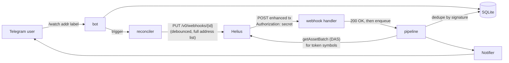

# solwatch

A Telegram bot that pings you when a Solana wallet you care about does something.

```
/watch 2KNuy5aBQB58YeLRtj3pJWyXHztaf2jqHWnowThanHmZ jup trader

🔔 jup trader: swapped 0.08221 SOL → 828,678.81 GROK on Jupiter · view tx
🔔 jup trader: swapped 6,902.46 PERPSPAD → 0.1075 SOL on Jupiter · view tx
```

(Those are real alerts from a test run against mainnet.)

solwatch is a small Go service built on [Helius](https://helius.dev) **enhanced
transaction webhooks**. It doesn't poll anything. Helius watches the chain, parses
each transaction that touches a watched address, and POSTs it to solwatch. solwatch
turns that into one readable line and sends it to whoever is watching the address.

I built it to learn the Helius data platform from zero. The write-up, including a
friction log of everything that tripped me up, is in [POST.md](POST.md).

## How it works



- **One webhook for everyone.** Every user's addresses go into a single Helius
  webhook. Each `/watch` or `/unwatch` triggers a reconcile that PUTs the full,
  deduplicated address list. Bursts are debounced into one call, and no-op syncs are
  skipped, because every create/edit/delete costs 100 credits.
- **Respond fast, work later.** Helius expects a `200` within about a second, so the
  HTTP handler only checks the `Authorization` header, decodes the JSON and enqueues
  it. Symbol lookups and Telegram sends happen in a worker. If the queue is full, the
  handler returns `503` so Helius retries the delivery.
- **Idempotent.** Helius retries failed deliveries and says duplicates can happen.
  The transaction signature is the dedupe key (stored in SQLite and pruned after 24h).
  Alerts are at-most-once: the signature is marked before sending, so a crash loses an
  alert instead of sending it twice.
- **Readable alerts.** The structured `events.swap` is used when Helius provides it.
  Otherwise the watched wallet's net token and SOL flows are computed from
  `tokenTransfers`/`nativeTransfers`, and if there are none, Helius' `description` is
  used. Mints are resolved to tickers with DAS `getAssetBatch` and cached in SQLite.
- **Digests, not floods.** Alerts are buffered per chat and wallet and sent as one
  message per minute ("🔔 jup trader · 6 events in the last minute: 4 swaps, 2 sends",
  then up to five lines with tx links). A lone alert still goes out as a single line.
- **Telegram is just one Notifier.** Without a bot token, solwatch reads commands from
  stdin and prints alerts to stdout. That's how the end-to-end test was run.

## Quickstart

You need Go 1.24+, a Helius API key ([free](https://dashboard.helius.dev)), and a public
HTTPS URL that reaches port 8080. A Cloudflare quick tunnel works for local testing.

```sh
cp .env.example .env                               # set HELIUS_API_KEY (and TELEGRAM_BOT_TOKEN if you have one)
cloudflared tunnel --url http://127.0.0.1:8080     # in another terminal; put the https URL in PUBLIC_URL in .env
go run ./cmd/solwatch                              # then type: /watch <address> <label>
```

With no `TELEGRAM_BOT_TOKEN`, type commands into the terminal and alerts print there.
To use Telegram, create a bot with [@BotFather](https://t.me/BotFather), put the token in
`.env`, restart, and send the bot `/watch <address> <label>`.

The Telegram path has been tested live: `/start` and `/watch` from a real chat, and 20 swap
alerts delivered with `sendMessage` returning ok, 2.7–4.3s after block time. `/list`
and `/unwatch` have only been exercised in console mode and unit tests so far.


That run, before digests existed, is why `DIGEST_INTERVAL` now defaults to a minute.

### Docker

```sh
docker build -t solwatch .
docker run --env-file .env -p 8080:8080 -v solwatch-data:/data solwatch
```

Without Docker, [ko](https://ko.build) builds and pushes the same static image
(modernc SQLite is pure Go, so `CGO_ENABLED=0` works). This is how the hosted demo's
image is built:

```sh
KO_DOCKER_REPO=<registry>/solwatch ko build ./cmd/solwatch --bare --platform=linux/amd64
```

## Commands

| Command | What it does |
|---|---|
| `/watch <address> [label]` | Start watching an address. Run it again to change the label. |
| `/unwatch <address or label>` | Stop watching. |
| `/list` | Show what this chat is watching. |

Addresses are checked as base58 strings that decode to 32 bytes before anything goes
to Helius. That catches typos and pasted signatures.

## Configuration

Set these as environment variables or in `.env`. Real environment variables take
precedence over `.env`.

| Variable | Default | Description |
|---|---|---|
| `HELIUS_API_KEY` | **required** | Helius API key. Used for webhook management and DAS. |
| `PUBLIC_URL` | **required** | Public `https://` base URL. Helius POSTs to `PUBLIC_URL/webhooks/helius`. |
| `TELEGRAM_BOT_TOKEN` | unset | BotFather token. If unset, solwatch runs in console mode (stdin/stdout). |
| `WEBHOOK_SECRET` | generated | Value Helius sends back in the `Authorization` header. If unset, a random one is generated and stored in the DB. |
| `LISTEN_ADDR` | `:8080` | HTTP listen address. |
| `DB_PATH` | `solwatch.db` | SQLite file. |
| `EXPLORER_TX_URL` | `https://solscan.io/tx/%s` | Link pattern for "view tx". |
| `HELIUS_WEBHOOK_TYPE` | `enhanced` | Set to `enhancedDevnet` for devnet. |
| `DELETE_WEBHOOK_ON_EXIT` | `false` | Delete the Helius webhook on shutdown. Useful with quick tunnels, whose URL changes on every run. |
| `CAPTURE_DIR` | unset | Save every authenticated webhook body here. This is how `testdata/` was recorded. |
| `CONSOLE_CHAT_ID` | `1` | Chat ID used for commands in console mode. |
| `LOG_LEVEL` | `info` | `debug`, `info`, `warn` or `error`. Logs are JSON on stderr. |

### Alert grouping and demo guardrails

Every webhook event costs a credit, so a public instance needs limits. The defaults
are what the hosted demo runs with. Set a number to `0` to turn that limit off.

| Variable | Default | Description |
|---|---|---|
| `DIGEST_INTERVAL` | `60s` | Buffer alerts per chat and wallet and send one digest per interval. A single alert still goes out as one normal line. `0` sends every alert immediately. Buffered alerts are flushed on shutdown. |
| `DIGEST_MAX_LINES` | `5` | Transactions listed in a digest before "+N more". |
| `MAX_WATCHES_PER_CHAT` | `3` | Wallets one chat can watch. |
| `MAX_WATCHED_ADDRESSES` | `50` | Distinct wallets across all chats. This is also the size of the Helius webhook's address list. |
| `WATCH_TTL` | `24h` | Watches expire after this, and the chat gets a note saying how to re-add it. |
| `HOT_ADDRESS_MAX_PER_MIN` | `30` | If a watched wallet produces more events than this in a minute, it's unwatched for every chat and they're told why. |
| `HOT_ADDRESS_BLOCK` | `24h` | How long an evicted hot wallet can't be watched again. |
| `WALLETS_ONLY` | `true` | `/watch` calls `getAccountInfo` (1 credit). Programs (executable accounts) and sysvars are always refused. With this on, so is anything not owned by the System Program: token mints, pools and other program accounts, which are the busiest addresses on chain. |
| `COMMANDS_PER_MINUTE` | `10` | Per-chat command rate limit. The first command over the limit gets a warning; later ones are ignored until the minute is up. |
| `USAGE_LOG_INTERVAL` | `1h` | How often to log a `usage` line with today's (UTC) webhook events, webhook API calls, DAS and RPC calls, and an estimated credit total. |
| `REPO_URL`, `WRITEUP_URL` | this repo, the blog post | Links shown in `/start`. |

## Helius limits that shape the design

These come from the Helius docs and from behavior I observed while building this.

| What | Value | Source |
|---|---|---|
| Free plan | 1M credits/month, 10 RPC req/s, 2 req/s for DAS and Enhanced APIs | [Plans](https://www.helius.dev/docs/billing/plans) |
| Webhook event | 1 credit per delivered event, whether or not your endpoint accepts it | [Webhooks](https://www.helius.dev/docs/webhooks) |
| Create / edit / delete webhook | 100 credits per call | [Webhooks](https://www.helius.dev/docs/webhooks) |
| Addresses per webhook | 100,000 via API, 25 via dashboard | [FAQ](https://www.helius.dev/docs/faqs/webhooks), [Quickstart](https://www.helius.dev/docs/webhooks/quickstart) |
| Webhooks per account | Not in the current plan table. The legacy table says Free = 1, but my free key created a second one without error | observed |
| Ack deadline | Return `200` within 1 second | [FAQ](https://www.helius.dev/docs/faqs/webhooks) |
| Retries | Up to 3, 1 second apart, on 5xx, 4xx except 403, timeouts and connection errors. After that the event is gone | [FAQ](https://www.helius.dev/docs/faqs/webhooks) |
| Auto-disable | At least 95% failures over 24h (free) or 7 days (paid) | [Webhooks](https://www.helius.dev/docs/webhooks) |
| Failed transactions | Enhanced webhooks don't send them; raw webhooks do | [FAQ](https://www.helius.dev/docs/faqs/webhooks) |
| Empty address list | Rejected with `400 At least one account address is required` | observed |
| `PUT` semantics | `webhookURL`, `webhookType`, `transactionTypes` are required on every PUT. An omitted `authHeader` is kept | observed |

Credit math for a free plan: an active trading wallet does around 100 transactions an
hour, which is about 72k credits a month per wallet. A million credits covers about a
dozen busy wallets, or many quiet ones.

Helius now describes [Parsed Streams](https://www.helius.dev/docs/parsed-streams) (a
WebSocket) as the successor to enhanced transaction webhooks, at the same 1 credit per
event. Webhooks still work, and for a bot that only needs to be told things they're the
simplest fit. See POST.md for the comparison.

## Development

```sh
go test ./...
```

The alert formatter is tested against real webhook bodies in
[`testdata/payloads/`](testdata/payloads). They were captured from mainnet with
`CAPTURE_DIR` while watching a few busy trading wallets. They cover Jupiter swaps with and
without `description`, a DFlow route Helius labeled `UNKNOWN`, sells that came through as
`CLOSE_ACCOUNT`, SOL transfers, and a Token-2022 account close with no transfers at all.

```
cmd/solwatch        wiring, config, graceful shutdown
internal/helius     payload types, webhook API client, DAS lookup
internal/reconcile  keeps the Helius webhook in sync with the watch list
internal/server     webhook HTTP handler (auth, decode, enqueue)
internal/pipeline   dedupe, route, resolve symbols, notify
internal/alert      pure formatting: enhanced tx -> one line
internal/bot        /watch /unwatch /list, Telegram + console front-ends
internal/notify     Notifier interface: Telegram, stdout
internal/telegram   minimal Bot API client
internal/store      SQLite
```

## Caveats

- Events that arrive while solwatch is down are lost after Helius' 3 retries. Webhooks
  have no replay. If you need replay, look at LaserStream (paid plans).
- Quick tunnel URLs change on every restart. solwatch notices the new `PUBLIC_URL` and
  updates the webhook (100 credits). For anything long-lived, use a stable hostname.
- Alerts are at-most-once by design.
